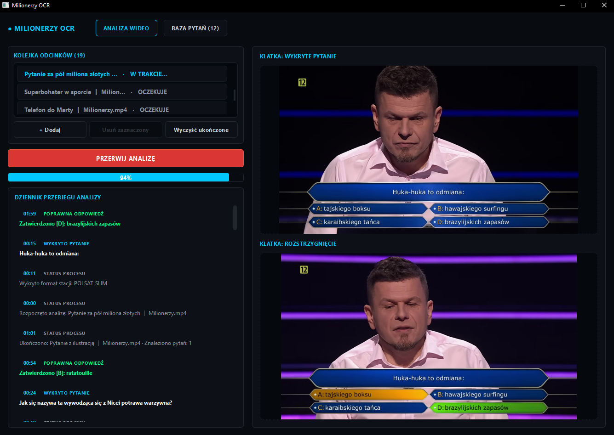
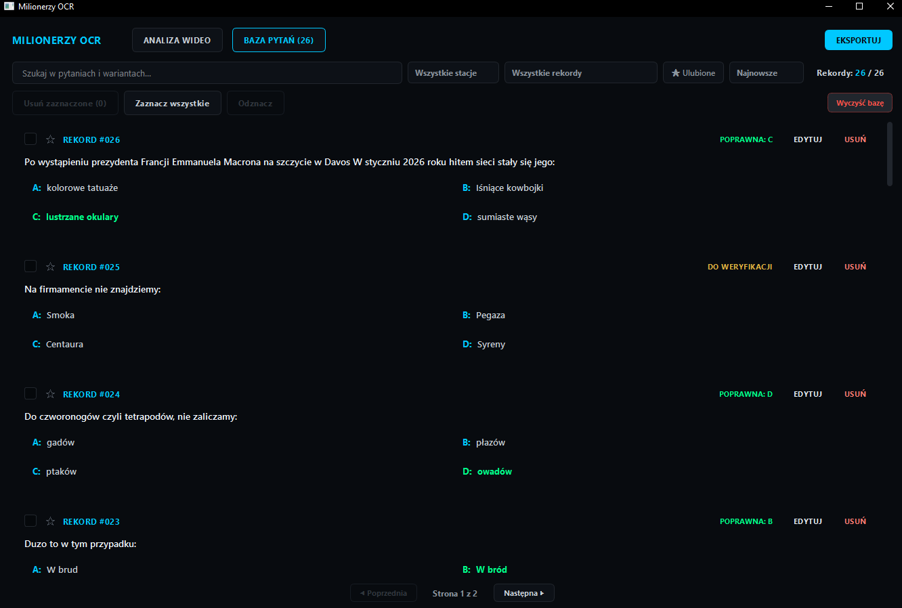
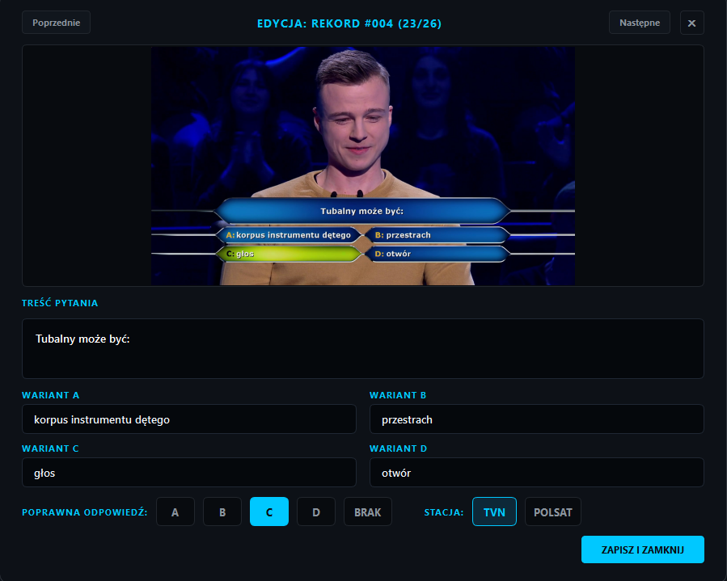

# MilionerzyOCR

Aplikacja desktopowa do automatycznego wyciągania pytań, wariantów odpowiedzi oraz poprawnych wskazań z nagrań wideo teleturnieju *Milionerzy*. Program przetwarza odcinki w tle, rozpoznaje układ planszy za pomocą OpenCV, odczytuje polskie znaki przez EasyOCR i zapisuje wszystko w przeszukiwalnej bazie z opcją eksportu m.in. do Anki, Excela czy PDF.

---

## Zrzuty ekranu

### 1. Przetwarzanie odcinków i podgląd klatek na żywo
Kolejka wideo z podglądem postępu, logami detekcji w czasie rzeczywistym oraz klatkami: bazową (pytanie) i wynikową (rozstrzygnięcie).

---

### 2. Baza pytań, filtrowanie i operacje masowe
Zestawienie rozpoznanych pozycji z podziałem na edycje TVN / Polsat, statusem weryfikacji, selekcją checkboxami oraz paginacją.

---

### 3. Weryfikacja i edycja rekordu
Okno edycji z bezpośrednim podglądem zapisanej klatki wideo, umożliwiające szybką korektę tekstu OCR, zmianę stacji oraz oznaczenie poprawnej litery.

## Co robi ten program?

Ręczne spisywanie setek pytań z kilkudziesięciu odcinków teleturnieju to żmudna praca. MilionerzyOCR automatyzuje cały ten proces: wrzucasz pliki wideo, program sam znajduje momenty z planszą pytania, czeka na zaznaczenie odpowiedzi przez gracza, odczytuje tekst i odkłada gotowy rekord do bazy.

### Dwufazowa analiza planszy (OpenCV + EasyOCR)
System śledzi dedykowane obszary ekranu (ROI) pod kątem zmian w strukturze planszy:
1. **Detekcja planszy pytania:** Wykrycie pojawienia się pytania i 4 kafelków odpowiedzi. Z tej klatki EasyOCR odczytuje treść pytania oraz warianty A, B, C i D z pełną obsługą polskich znaków.
2. **Detekcja rozstrzygnięcia:** Ciągła analiza przestrzeni barw HSV pod kątem zielonego podświetlenia prawidłowego kafelka (A, B, C lub D). Jeśli prawidłowa odpowiedź zostanie potwierdzona wizyjnie, program automatycznie przypisuje właściwą literę. W przypadku rezygnacji gracza, końca czasu odcinka lub cięcia montażowego rekord trafia do bazy z oznaczeniem `DO WERYFIKACJI`.

Wspierane są profile graficzne wydań **TVN** oraz **Polsat** (program w logach sam odnotowuje wykryty format planszy, np. `POLSAT_SLIM`).

### Kolejka zadań i praca wielowątkowa
* **Wsadowe przetwarzanie:** Wrzucasz do listy wiele plików (`.mp4`, `.mkv`, `.avi`), a program przetwarza je kolejno bez zawieszania okna (silnik działa w osobnym `QThread`).
* **Bezpieczne przerywanie:** Przycisk `PRZERWIJ ANALIZĘ` zatrzymuje pętlę bez psucia bazy i bez usuwania pliku z listy — analizę można wznowić w dowolnym momencie.
* **Dziennik zdarzeń:** Log z dokładnymi sygnaturami czasowymi (`MM:SS`), informujący o wykrytych pytaniach, zatwierdzonych literach i zmianach stanu.

### Pełny CRUD i zarządzanie bazą
* **Podgląd i stronicowanie:** Baza podzielona na strony z płynnym przełączaniem, zabezpieczona przed wyciekami pamięci przy dużej liczbie elementów.
* **Edytor ze zrzutem klatki:** Kliknięcie `EDYTUJ` otwiera modal z oryginalną klatką z nagrania — od razu widać, czy OCR nie popełnił literówki, z możliwością natychmiastowej poprawy tekstu i stacji.
* **Operacje masowe:** Przyciski `Zaznacz wszystkie`, `Odznacz` oraz masowe usuwanie wybranych pozycji (program automatycznie czyści z dysku powiązane pliki zrzutów z folderu `captures/`).
* **Spójna numeracja:** Wbudowany mechanizm reindeksacji pilnuje, żeby po skasowaniu wpisów identyfikatory (`#001`, `#002`, ...) pozostały unikalne i ciągłe.
* **Wyszukiwanie i filtry:** Szukanie pełnotekstowe po pytaniach i wariantach, filtr stacji (**TVN** / **Polsat**), filtrowanie po literach (A/B/C/D), filtr pytań niekompletnych (`Do weryfikacji`) oraz oznaczanie gwiazdką (`Ulubione`).

### Eksport danych
Zgromadzone pytania można wyeksportować do formatów zewnętrznych:
* **Fiszki Anki (`.txt`):** Gotowy format do nauki (pytanie na przodzie, warianty i poprawna odpowiedź na odwrocie).
* **Excel (`.xlsx`) oraz CSV:** Zestawienia tabelaryczne z podziałem na kolumny pod dalszą obróbkę.
* **Word (`.docx`) / PDF:** Gotowe szablony testów z kluczem odpowiedzi.

---

## Zależności techniczne

| Obszar | Rozwiązanie | Uwagi |
| :--- | :--- | :--- |
| Środowisko | Python 3.11 | Wersja zalecana ze względu na kompatybilność binarną PyTorch i PyInstallera |
| GUI | PySide6 (Qt 6.6+) | Ciemny motyw QSS, asynchroniczna architektura sygnałów |
| Przetwarzanie obrazu | OpenCV | Detekcja planszy, progowanie, maskowanie barw HSV |
| Rozpoznawanie tekstu | EasyOCR (PyTorch, torchvision) | Sieć neuronowa CRAFT + CRNN zoptymalizowana pod język polski |
| Przechowywanie danych | JSON + katalog `captures/` | Relacja wpisów z plikami graficznymi na dysku |
| Obsługa formatów | Pandas, OpenPyXL, python-docx | Eksport do arkuszy kalkulacyjnych i dokumentów |

---